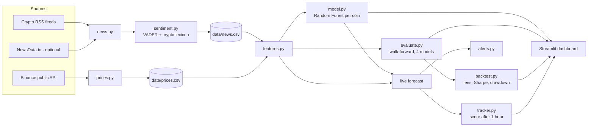
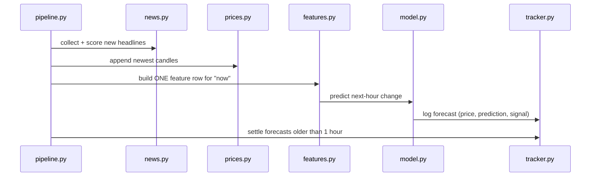

# Architecture

## System overview

## Live forecast cycle (every 5 minutes)

## Data model
| File | Columns |
|---|---|
| `data/news.csv` | title, published_at (UTC), source, url, sentiment_score, sentiment_label |
| `data/prices.csv` | time (UTC), coin, price (5-minute close) |
| `data/predictions.csv` | time, coin, price, predicted_change_pct, signal, actual_change_pct, correct, settled |
| `models/model_<COIN>.pkl` | trained Random Forest |
| `models/comparison_<COIN>.json`, `backtest_<COIN>.json` | evaluation results |

## Features (identical for training and live)
`sentiment_mean`, `sentiment_strength`, `n_headlines` (headlines in the previous 60 min), `hour` (UTC), `volatility` (std of 5-min returns, 20 candles), `momentum_pct` (previous 1-hour return).
Label: % price change from t to t + 60 min.

## Key design decisions
| Decision | Why |
|---|---|
| One feature function for training and live | Prevents train/serve skew |
| Rolling 60-min sentiment window | Defined at any time t, so live prediction is possible |
| Label uses future price only as target | No look-ahead leakage; covered by unit tests |
| Gap = horizon between train and test | Overlapping labels cannot leak across the split |
| p-value uses ~n/12 effective samples | Rows 5 min apart share a 60-min label, so they are not independent |
| Per-coin models | Different volatility and news sensitivity |
| CSV storage | Simple and inspectable; SQLite/Postgres is the next step |
| Failures are logged, not fatal | One broken feed must not stop the collector |

## Failure modes
| Failure | Behaviour |
|---|---|
| RSS feed down | Warning logged, other feeds continue |
| Binance unreachable | Falls back to the public market-data mirror; if both fail the cycle logs a warning and the dashboard shows an error instead of crashing |
| No trained model | Dashboard explains how to train; collector skips forecasting |
| Not enough rows | Training refuses with a clear message instead of fitting noise |
| Stale data | `python -m crypto_sentiment.status` reports NOT LIVE |

## Scaling path
CSV → SQLite/Postgres; cron loop → scheduler (Airflow/Prometheus alerts); single process → message queue (Kafka) between collectors and feature builder; VADER → FinBERT served behind an API.
